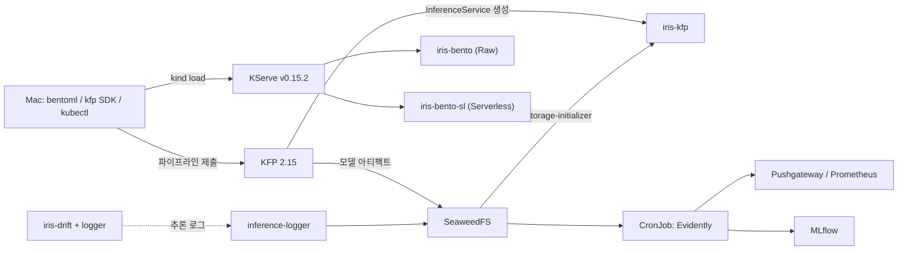
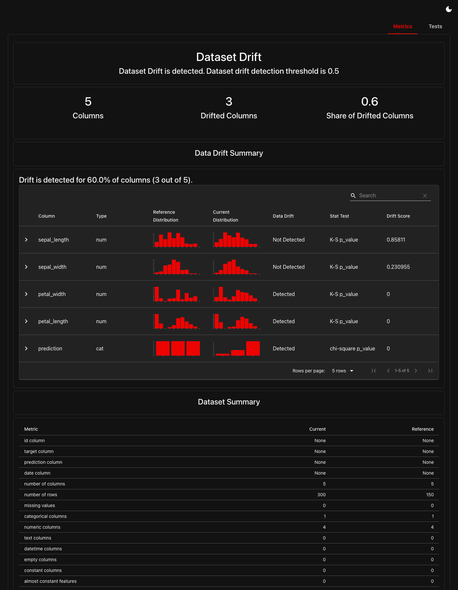

# bentoml-lab: Kubeflow 1.11 + BentoML 1.4 + KServe 0.15 모델 서빙 실습

Apple Silicon Mac 한 대(Colima + kind)에 올린 Kubeflow 1.11 클러스터에서 다음 세 가지를 실습하는 코드입니다.

1. **KServe 기본 런타임**과 **BentoML로 만든 커스텀 서빙 이미지**를 RawDeployment / Serverless(Knative) 모드로 배포
2. **Kubeflow Pipelines(KFP)**로 학습 → 평가 → 배포 → 스모크 테스트 자동화
3. KServe 추론 로그를 수집하고 **Evidently CronJob**으로 데이터 드리프트를 주기적으로 검사

> 📖 **상세한 설명, 실행 결과, 트러블슈팅은 블로그 글을 참고하세요.**
>
> [3주차: Mac 한 대에서 Kubeflow 1.11 + BentoML 1.4 + KServe 0.15로 모델 서빙하기 — KFP 자동 배포와 Evidently 드리프트 모니터링까지](https://velog.io/@sejkim/3%EC%A3%BC%EC%B0%A8-Mac-%ED%95%9C-%EB%8C%80%EC%97%90%EC%84%9C-Kubeflow-1.11-BentoML-1.4-KServe-0.15%EB%A1%9C-%EB%AA%A8%EB%8D%B8-%EC%84%9C%EB%B9%99%ED%95%98%EA%B8%B0KFP-%EC%9E%90%EB%8F%99-%EB%B0%B0%ED%8F%AC%EC%99%80-Evidently-%EB%93%9C%EB%A6%AC%ED%94%84%ED%8A%B8-%EB%AA%A8%EB%8B%88%ED%84%B0%EB%A7%81%EA%B9%8C%EC%A7%80)

## 실습 환경

| 구성 요소 | 버전 |
|---|---|
| Colima | aarch64, 8 CPU / 16GiB, docker 런타임 |
| kind | v0.33.0, 클러스터 `myk8s` (control-plane 1 + worker 2) |
| Kubernetes | v1.34.0 (arm64) |
| Kubeflow | v1.11.0 (KFP 2.15.0, 저장소 SeaweedFS `minio-service`) |
| KServe | v0.15.2 (기본 배포 모드 Serverless) |
| Istio / Knative | Istio 1.28.0 / Knative Serving (net-istio) |
| BentoML | 1.4.40 |
| KFP SDK | `kfp` 2.15.2, `kfp-kubernetes` 2.15.2 |
| Python | 3.11 (uv) |
| Evidently | 0.7.23 (pandas 2.3.3 고정) |
| 기타 | Prometheus + Pushgateway, Grafana, MLflow 3.16.0 |

모든 리소스는 Kubeflow 사용자 네임스페이스 `kubeflow-user-example-com`에 배포합니다.

## 디렉터리 구성

```text
bentoml-lab/
├── service.py                     # BentoML 서비스 (Iris 분류기)
├── bentofile.yaml                 # Bento 빌드 설정
├── run-lab.sh                     # 빌드 → kind 적재 → KServe 배포 → 호출
├── check-env.sh                   # Colima / kind / Kubeflow / KServe 환경 점검
├── k8s/
│   ├── sklearn-iris.yaml          # KServe 내장 sklearn 런타임 (Serverless)
│   ├── isvc-bento-raw.yaml        # Bento → RawDeployment
│   └── isvc-bento-serverless.yaml # Bento → Serverless (minReplicas 0)
├── pipeline/
│   ├── iris_pipeline.py           # KFP 파이프라인 정의 (컴포넌트 5개)
│   ├── run_pipeline.py            # 컴파일 + 실행 제출 + 완료 대기
│   ├── run-pipeline.sh            # 포트포워딩, 토큰 발급, 제출, 결과 호출
│   └── iris_pipeline.yaml         # 컴파일 결과 (자동 생성)
├── drift/
│   ├── app/                       # logger_server.py, drift_job.py, traffic.py
│   ├── k8s/                       # ConfigMap, 로그 수신기, isvc, 기준 데이터 Job, CronJob
│   ├── Dockerfile, requirements.txt
│   └── run-drift-lab.sh           # build / deploy / traffic / report / view / clean
└── images/
    └── evidently-drift-report.png
```

## 빠른 시작

```bash
# 0. 환경 점검
./check-env.sh

# 1. BentoML 빌드 + KServe 배포 (sklearn / RawDeployment / Serverless)
./run-lab.sh all          # 단계별: build | sklearn | raw | serverless | status | clean

# 2. KFP 파이프라인: 학습 → 평가 → 배포 → 스모크 테스트
cd pipeline
./run-pipeline.sh                             # n_estimators=100, accuracy_threshold=0.85
./run-pipeline.sh --n-estimators 10           # 같은 isvc 를 새 Revision 으로 갱신
./run-pipeline.sh --accuracy-threshold 1.01   # 기준 미달 → 배포 건너뜀
./run-pipeline.sh clean
cd ..

# 3. 추론 로그 수집 + Evidently 드리프트 모니터링
cd drift
./run-drift-lab.sh all    # build → deploy → traffic normal → report → traffic drift → report
./run-drift-lab.sh view   # http://localhost:8090/reports
./run-drift-lab.sh clean
```

스크립트 기본값은 환경변수(`CLUSTER=myk8s`, `NS=kubeflow-user-example-com`, `IMAGE` 등)로 바꿀 수 있습니다. `IMAGE`를 바꾸면 매니페스트의 `image`도 함께 바꿔야 합니다.

## 아키텍처 요약



## 주요 함정 (요약)

- 인그레스 게이트웨이는 Dex JWT만 받습니다. 로컬 실습은 `kubectl port-forward`로 호출합니다.
- Serverless로 로컬 이미지를 쓰려면 `dev.local/...` 태그를 붙여 Knative의 digest 조회를 건너뜁니다.
- scale-to-zero는 knative 어노테이션 대신 `spec.predictor.minReplicas: 0`으로 지정합니다.
- KFP 파드에는 Istio 사이드카가 없어 isvc 호출이 403이 납니다. 스모크 테스트 태스크에 `sidecar.istio.io/inject: "true"` 라벨을 붙입니다.
- 학습 환경을 KServe sklearnserver v0.15.2(sklearn 1.5.2 / joblib 1.4.2 / numpy 2.0.2)에 맞춰야 pickle이 호환됩니다.
- 추론 로그는 에이전트 포트(9081)로 호출해야 남습니다. 8080은 logger를 우회합니다.
- Evidently 0.7.23은 pandas 3에서 import가 실패하므로 pandas 2.3.3으로 고정합니다.
- Mac이 잠든 뒤 Colima가 `Broken`이 되면 `colima stop --force && colima start`로 복구합니다.

나머지 함정과 해결 과정은 [블로그 글의 "실습하면서 만난 함정" 장](https://velog.io/@sejkim/3%EC%A3%BC%EC%B0%A8-Mac-%ED%95%9C-%EB%8C%80%EC%97%90%EC%84%9C-Kubeflow-1.11-BentoML-1.4-KServe-0.15%EB%A1%9C-%EB%AA%A8%EB%8D%B8-%EC%84%9C%EB%B9%99%ED%95%98%EA%B8%B0KFP-%EC%9E%90%EB%8F%99-%EB%B0%B0%ED%8F%AC%EC%99%80-Evidently-%EB%93%9C%EB%A6%AC%ED%94%84%ED%8A%B8-%EB%AA%A8%EB%8B%88%ED%84%B0%EB%A7%81%EA%B9%8C%EC%A7%80)에 정리돼 있습니다.

## 드리프트 리포트 예시


